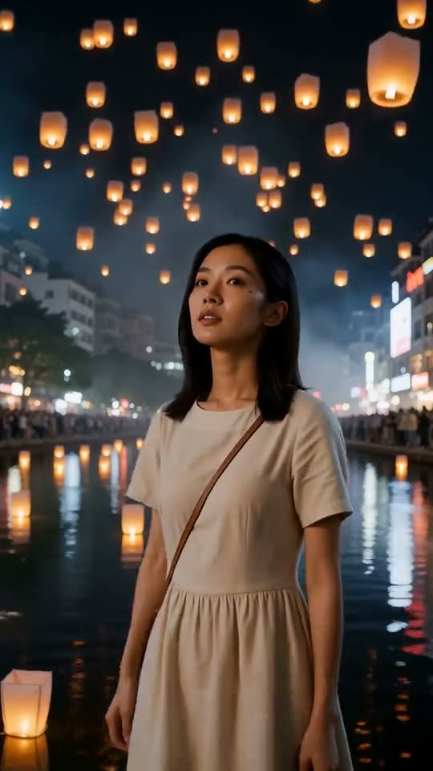

**Official examples for AI Video Creator** — real clips, the prompts behind them, and the honest limits.

---

**AI Video Creator** ([aivideocreator.io](https://aivideocreator.io)) turns one text prompt into a finished 15-second vertical video **with sound**: 2K, 9:16, MP4 download, made for TikTok, Instagram Reels, and YouTube Shorts. No timeline, no editing app — one sentence in, one postable clip out.

This repository is the official examples library: every video here is a **real generation** from AI Video Creator, published together with the prompt that produced it, so you can judge the output before you try it.

## What is in this repo

| Path | Contents |
|---|---|
| `videos/` | 4 real example clips (MP4, playable right here in the README) |
| `examples/prompts.md` | The prompt recipes behind them + 7 more starting points (**published subset**) |
| `docs/workflow.md` | End-to-end: prompt → shot list → generate → download/QR → post |
| `docs/limits.md` | What the tool honestly cannot do (yet) |
| `assets/` | Logo and video posters |

## Real examples

Click a poster to play the clip (raw MP4). Every clip: **15 seconds · 2K · 9:16 vertical · native stereo sound**, generated in a single pass. Currently the service runs on **MiniMax H3** (see the [model disclosure](https://aivideocreator.io/about)).

| Clip | Prompt that produced it (published subset) |
|---|---|
| <a href="videos/stadium-goal.mp4"> ▶ stadium-goal.mp4</a> | *"A striker in a red kit beats the last defender and finishes under floodlights, low camera at pitch level, crowd roar."* |
| <a href="videos/lantern-festival.mp4"> ▶ lantern-festival.mp4</a> | *"A woman releases a paper lantern onto a dark river, hundreds of lights rising around her, slow push-in, soft wind and bells."* |
| <a href="videos/paper-boat-vertical.mp4"> ▶ paper-boat-vertical.mp4</a> | *"A paper boat drifts through a glowing night city, low angle close to the water, quiet synth hum."* |

More starting points in [`examples/prompts.md`](examples/prompts.md).

## Quick start

1. **Describe your scene in one sentence** — subject, action, setting, camera, mood.
2. **Press Enhance** to expand it into a timed 0–15s shot list with camera work and a soundscape.
3. **Generate**, then download the MP4 — or scan the QR code on the result page to save it straight to your phone and post it.

Every email-verified account gets **one free preview** (768p, 5 seconds, sound included) before paying. Packs are one-time: .9 / 2 videos · .9 / 5 · .9 / 11 — they never expire, and failed generations return the credit automatically.

## Honest limits

- Length is fixed at 15 seconds — no 30s/60s mode.
- No timeline editing: change the prompt, not the clips.
- Generation takes a few minutes, not seconds.
- Audio is generated scene sound and music — not scripted voiceover.
- Real people, brands, and logos are not supported.

Full details: [docs/limits.md](docs/limits.md) · Deep-dive guides: [aivideocreator.io/blog](https://aivideocreator.io/blog)

## License

Media and prompts in this repo are released under [CC BY 4.0](LICENSE) — attribute as "AI Video Creator (aivideocreator.io)". The AI Video Creator name and logo are trademarks and **not** covered by the license. This project is not affiliated with TikTok, Instagram, or YouTube.
